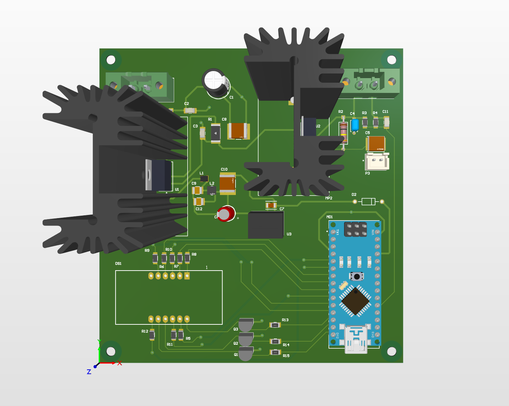
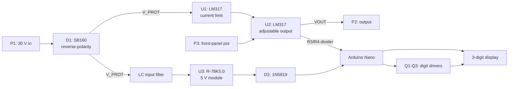
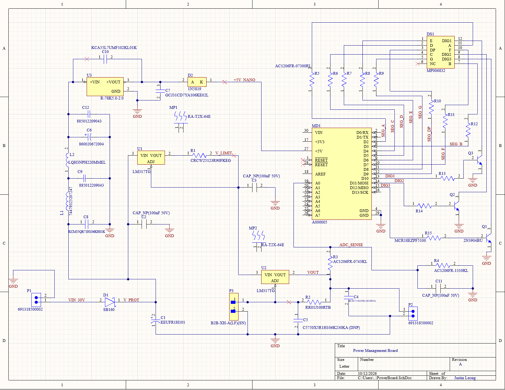
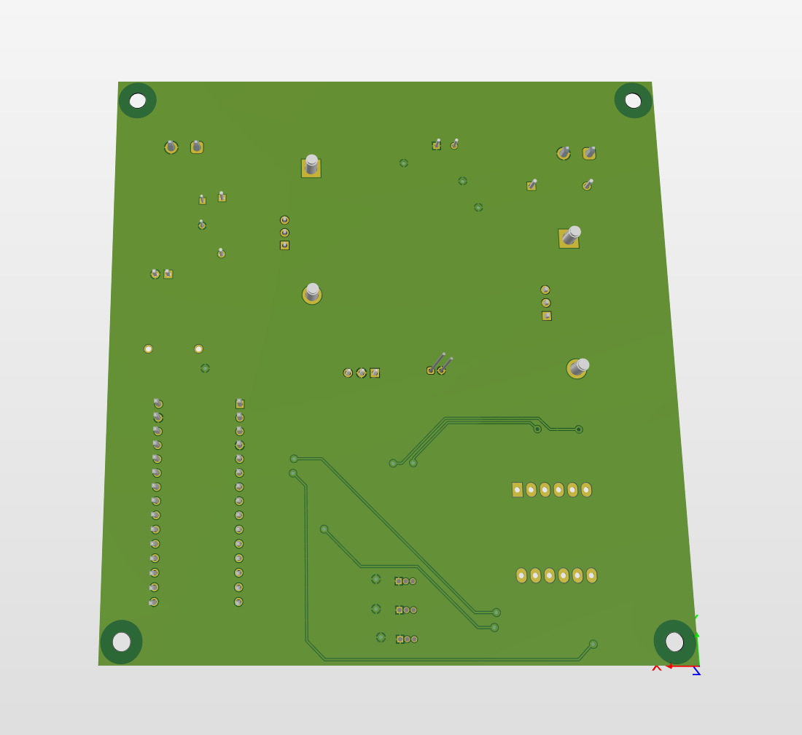
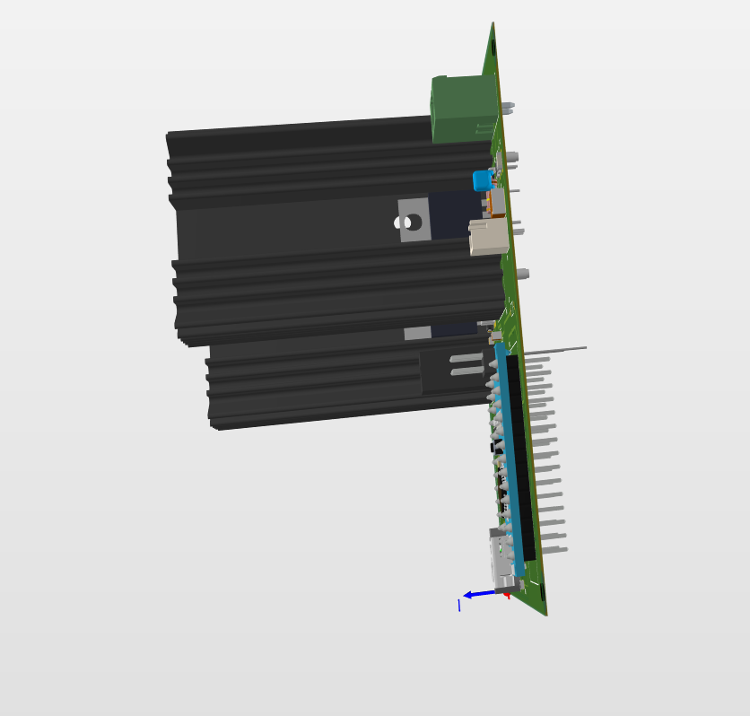

# Power Management Board

An adjustable linear bench power supply on a 2-layer PCB. It takes a 30 V DC adapter, outputs 1.25 V to about 22 V with a 0.3 A current limit, and shows the output voltage on a 3-digit display driven by an Arduino Nano.

**Status:** Schematic and PCB layout complete, with 0 design rule violations. Boards not yet fabricated or tested.

## Specifications

| Item | Value |
|---|---|
| Input | 30 V DC, screw terminal (P1) |
| Output | 1.25 V to ~22 V, set by a front-panel potentiometer (target: at least 21 V) |
| Current limit | ~0.32 A (1.25 V across a 3.9 Ω sense resistor) |
| Protection | Reverse-polarity diode, current limit, LM317 thermal shutdown |
| Display | 3-digit 7-segment, multiplexed by an Arduino Nano |
| Logic supply | 5 V from a RECOM R-78K5.0-2.0 switching module |
| PCB | 2 layers, 107 × 111 mm, 1 oz copper, 44 parts (25 SMD, 19 through-hole) |
| Design tool | Altium Designer 26 |

## Block diagram

## Schematic

## How it works

**Input protection.** D1, an SB160 Schottky diode, blocks current if someone plugs the adapter in backwards. It drops about 0.5 V, so the internal rail (V_PROT) sits near 29.5 V.

**Current limit (U1).** U1 is an LM317 wired as a constant-current source. It holds 1.25 V across R1 (3.9 Ω), which caps the output at about 0.32 A, even into a short circuit.

**Voltage regulator (U2).** U2 is an LM317 in its standard adjustable circuit. A potentiometer on connector P3 sets the output voltage. C5 on the ADJ pin is a do-not-populate footprint, reserved for ripple reduction if testing calls for it.

**5 V logic supply (U3).** A RECOM switching module converts V_PROT to 5 V for the Nano. L1, L2 and ceramic capacitors form an input filter that keeps switching noise off the input rail. D2 stops USB power from feeding back into U3 when the Nano is plugged into a computer.

**Measurement and display.** R3 (43 kΩ) and R4 (10 kΩ) divide VOUT by 5.3, so a 22 V output reads as about 4.2 V on the Nano's A0 pin, inside its 0 to 5 V range. C11 filters the reading. The Nano multiplexes the display: R5 to R12 limit segment current, and Q1 to Q3 (2N3904) switch each digit's common pin through base resistors R13 to R15.

## Design decisions

| Decision | Reason |
|---|---|
| 30 V input | Reaching 21 V at the output costs about 0.5 V in D1, 3.25 V in U1 and 2 V of U2 dropout. 30 V leaves a maximum near 22 V. |
| 0.3 A current limit | A lower limit keeps the heatsinks small enough for the enclosure. |
| Separate heatsink per LM317 | Worst case, U2 dissipates ~7.6 W (1.25 V out at 0.3 A) and U1 ~9 W into a shorted output. Each regulator bolts to an Ohmite RA-T2X-64E (3.1 °C/W) through an insulating pad. Each LM317 tab carries that regulator's output voltage, so the heatsinks must not touch. |
| Switching module for 5 V | A 7805 running from 30 V would waste about 2.5 W at 100 mA. The R-78 module needs no heatsink. |
| Hand assembly | Most parts are through-hole or 1206 size, and the Nano, display and heatsinks need hand soldering at any factory. |

## PCB layout

- **Layers:** signals and power on top, a GND pour on the bottom with thermal-relief connections for easier hand soldering. A few display segment traces cross to the bottom layer through vias, so the pour is broken in the lower-left area under those traces.
- **Trace widths:** 0.6 mm for a 10-net Power class (input, protected rail, both regulator outputs, the 5 V path and GND); 0.254 mm for signals.
- **Clearance:** 0.152 mm (6 mil), with margin above JLCPCB and PCBWay minimums.
- **Placement:** power path and connectors along the back edge, display and knob connector toward the front, Nano USB port left clear for programming. Electrolytic capacitors sit 10 to 15 mm from the heatsinks, since each 10 °C of extra heat roughly halves their life.
- **Mounting:** four non-plated 3.2 mm holes for M3 screws, each with a 3.5 mm keep-out ring for the screw head.

| Top (2D) | Bottom (3D) |
|---|---|
|  |  |

### Documented rule exceptions

- **Q1 to Q3 solder mask sliver.** The TO-92 pads sit 8.66 mil apart. With 4 mil mask expansion per side, the sliver between them is 0.66 mil, below any fab's minimum. The fab removes it, which works for hand-soldered through-hole transistors. A scoped rule covers only these three parts.
- **U1/U2 overlap MP1/MP2.** Each regulator bolts to its heatsink, so the footprints overlap by design. A scoped component-clearance rule at 0 mm still flags any 3D interference between the parts.

## Assembly notes

- **Regulators:** insert U1 and U2 without soldering, bolt each tab to its heatsink through the insulating pad, then solder the legs. The screw sets the height; the regulator body ends up 2 to 4 mm above the board.
- **C1 polarity:** the silkscreen line marks the negative (GND) side, at the square pad. C6 uses a "+" mark instead. The board uses both conventions, so check each capacitor.
- **Enclosure:** the heatsinks stand 63.5 mm tall. Print the box in PETG or ASA (PLA softens near 60 °C) and put vents above both heatsinks.

## Roadmap

- [x] Requirements and block design
- [x] Schematic and validation
- [x] Placement, routing, GND pour, clean DRC
- [ ] Gerber and drill export, bare board order
- [ ] Hand assembly and bring-up testing
- [ ] Nano firmware for the voltage display
- [ ] 3D-printed enclosure

## Files

| File | Contents |
|---|---|
| `Power Management Board.PrjPcb` | Altium project |
| `PowerBoard.SchDoc` | Schematic |
| `PowerBoard.PcbDoc` | PCB layout |
| `images/` | Schematic, layout and 3D render screenshots used in this README |

## Author

Justin Leong
